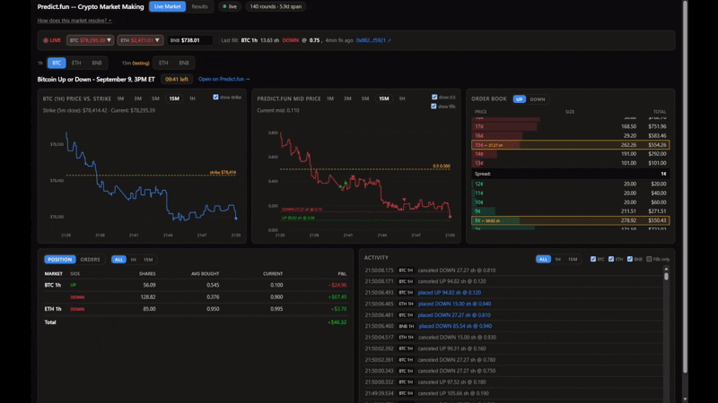

# Portfolio

I’m a Financial Engineering student at ESILV, focused on algorithmic trading and market-making.

I like building my own projects in finance, and my main one is market-making. Since November 2025, I’ve designed and operated automated market-making systems in Python and C++, running 24/7 on AWS. They have executed over 900,000 trades for more than $16M in volume, and have been profitable every month for the past twelve months. Most of my work now goes into analysing where the strategies lose money and improving the pricing and risk management behind them.

Alongside this, I enjoy taking part in trading competitions and hackathons:

• Susquehanna Predictions Cup 2026: top 20% of ~2,000 participants

• HackMeridian 2026 hackathon (Lisbon): 4th out of 165 teams

I’m currently looking for a trading or market-making internship starting April for 4-6 months.

Email: boghosazizianemin@gmail.com

---

## Resume

Download my resume: [Resume.pdf](./Resume.pdf)

---

## Projects

### Prediction Market Bots (November 2025 - Present)

Two automated market-making bots running live on prediction markets, placing thousands
of transactions per day and ranking in the top 1% of traders by PnL and volume.

["Here"](./PredictionMarketBots) you can find:

- **Polymarket mass market maker** : simultaneously quoting ~2,000 illiquid markets,
  200,000+ total transactions since November 2025
- **PredictFun Bitcoin bot** : sub-second market-making on Bitcoin up/down markets
  across 1h, 15min, and 5min timeframes, with quotes updating in less than 150ms
  - [Live dashboard](./PredictionMarketBots/predict_fun-btc/live_dashboard.md) : live order book, order placements, and PnL for the PredictFun bot

### Video Game Development (2021-2025)

A fast-paced wizard combat game that I am building on Unreal Engine 5.

["Here"](./WizardGame) you can find:

- Gameplay media and development timeline
- Blueprint architecture overview

---

## Skills

### Programming & Scripting
- Python, C#, C++, JavaScript, SQL, MQL
- Strong algorithmic thinking and problem-solving
- Object-oriented and event-driven programming
- Performance optimization and low-latency code in Python

### Automation & APIs
- REST and WebSocket API integration
- Handling rate limits, downtime, and unreliable data streams
- Designing systems that run continuously without supervision
- AWS deployment
- Async programming and concurrent I/O

### Quantitative Finance
- Options pricing with the Black-Scholes model
- Implied volatility extraction from live market prices
- Order book mechanics and market microstructure
- Market making, spread capture, and liquidity provision
- Adverse selection risk and how to mitigate it at scale
- Real-time pricing under latency constraints

### Game Development
- Unreal Engine 5
- Multiplayer logic and replication
- AI systems using behavior trees
- Level design and interaction-driven mechanics
